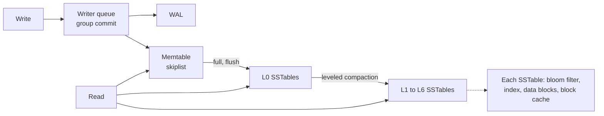
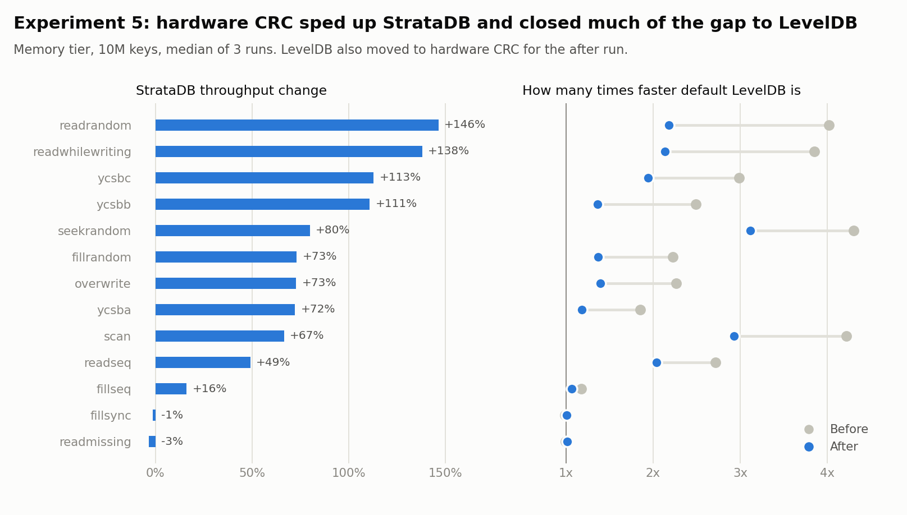

# StrataDB

An embedded key-value storage engine in C++20, built as a log-structured merge tree:
write-ahead log, skiplist memtable, SSTables with bloom filters, and leveled compaction.

It's a learning project, compared directly against LevelDB 1.23. On a 10M-key dataset LevelDB is still faster on most workloads, and [`docs/BENCHMARKS.md`](docs/BENCHMARKS.md) shows by how much and why. [`docs/DESIGN.md`](docs/DESIGN.md) covers the formats, compaction and trade-offs.



## Build and test

Requires CMake ≥ 3.25, Ninja, and GCC ≥ 12 or Clang ≥ 16.

```bash
cmake --preset debug          # or: asan, tsan, release, bench
cmake --build --preset debug
ctest --preset debug          # add -L unit or -L slow to filter
```

| Preset    | What it is for                                                     |
|-----------|--------------------------------------------------------------------|
| `debug`   | Day-to-day development, `STRATA_DCHECK` on                         |
| `asan`    | AddressSanitizer + UndefinedBehaviorSanitizer, `-Werror`           |
| `tsan`    | ThreadSanitizer, `-Werror`                                         |
| `release` | `-O2`, debug checks compiled out, `-Werror`                        |
| `bench`   | `-O2 -g -fno-omit-frame-pointer` for `perf` flame graphs, builds `strata_bench`, fetches LevelDB 1.23 |

CI runs `asan`, `tsan` and `release` (GCC and Clang) plus a `clang-format` check on every push.

Format before committing:

```bash
cmake --build --preset debug --target format
```

Run clang-tidy as part of a build:

```bash
cmake --preset debug -B build/tidy -DSTRATA_CLANG_TIDY=ON && cmake --build build/tidy
```

> **WSL2:** keep the repo inside the Linux filesystem (e.g. `~/strata`), not under `/mnt/c`.
> For TSan on recent kernels you may need `sudo sysctl -w vm.mmap_rnd_bits=28`.

## Repository layout

```
include/strata/   public API
src/util/         coding, crc32c, arena, hash, bloom, cache, histogram, random
src/env/          PosixEnv, FaultInjectionEnv
src/memtable/     skiplist, memtable
src/log/          WAL / MANIFEST record writer and reader
src/table/        blocks, SSTable builder and reader, iterators
src/db/           DBImpl, versions, compaction, DBIter
tests/            one *_test.cc per unit, plus model / crash / kill tests
bench/            strata_bench and engine adapters
tools/            sst_dump
docs/             DESIGN.md, BENCHMARKS.md, ROADMAP.md
```

Adding code needs no CMake edits:

- any `src/**/*.cc` is compiled into the `strata` library;
- each `tests/*_test.cc` becomes its own test binary (`model_test`, `crash_test` and
  `kill_test` are labelled `slow`, everything else `unit`);
- each `tools/*.cc` becomes an executable.

Re-run the configure step after adding a new file, or just build — the globs are checked on
every build.

## Benchmarks (`strata_bench`)

StrataDB includes `strata_bench`, a standalone benchmarking harness that evaluates identical workloads against StrataDB and LevelDB (pinned tag `1.23`).

### Build

```bash
cmake --preset bench
cmake --build --preset bench --target strata_bench
```

### Run

Run all workloads across both engines:

```bash
./build/bench/strata_bench --num=1000000 --threads=1
```

Quick smoke run:

```bash
./build/bench/strata_bench --num=10000 --engine=both --benchmarks=fillseq,readrandom --threads=2
```

Print each engine's stats, including write amplification, after a fill. Stats are printed after write workloads, once compactions finish, because their counters reset when the database reopens:

```bash
./build/bench/strata_bench --num=1000000 --benchmarks=fillrandom --stats
```

`--num` and the other count flags accept `K`, `M` and `G` (`--num=10M`). YCSB workloads can be tuned with `--ycsb_ops=N` (defaults to `--num`) and `--zipf_theta=F` (skew parameter in `(0, 1)`, default `0.99`). `--leveldb_mmap=0` makes LevelDB read with `pread` instead of its default `mmap`, and reports it as `LevelDB-nommap`. `--group_commit=0` gives every StrataDB write its own WAL record and sync, and needs `--engine=strata`. `--timeseries=PATH` writes progress and files per level during write workloads, every `--timeseries_interval_ms` (default 1000). Run `strata_bench --help` for every option.

To run the full comparison on a machine, with repeated runs, cache control and a summary, use `bench/run_benchmarks.sh`. `bench/run_experiments.sh` runs the experiments, `bench/profile.sh` makes flame graphs, and `bench/plot_experiments.py` draws the charts. [`docs/BENCHMARKS.md`](docs/BENCHMARKS.md) has the steps.

### Supported Workloads

- **Writes**: `fillseq`, `fillrandom`, `overwrite`, `fillsync`
- **Reads**:
  - `readrandom`: point lookups of keys that exist.
  - `readmissing`: lookups of keys that don't exist but fall inside the stored key range, so they exercise the bloom filters.
  - `readseq`: walks the whole key space with an iterator.
  - `seekrandom`: one seek per operation.
  - `scan`: a seek plus 100 entries per operation.
- **YCSB (Zipfian skew)**:
  - `ycsbc`: 100% reads (read-only).
  - `ycsbb`: 95% reads, 5% updates.
  - `ycsba`: 50% reads, 50% updates.
- **Mixed**: `readwhilewriting`: reader threads alongside one writer held to `--write_rate` (default 10,000 writes/s, 0 for no limit). The rate the writer reached is reported with the row.

### Datasets

Read workloads reuse the dataset left by an earlier fill only if it was built with the same `--num`, `--value_size`, `--write_buffer_size`, `--block_size`, `--bloom_bits` and `--threads`; otherwise it is rebuilt with `fillrandom`. `--cache_size` and `--max_open_files` can vary over one dataset. Workloads that change the data mark the dataset invalid first.

Before each read workload the database is reopened, leaving the block cache cold, and the harness waits until no level is over its compaction target. The CSV records which fill made the dataset (`dataset`) and the files per level at the start (`levels_at_start`). LevelDB also compacts in response to reads, which StrataDB doesn't, so its shape can change during one read workload and differ at the start of the next.

### Failures

Every read is checked: keys must be found with the right value size, missing keys must be missing, and seeks and scans must land where expected. If any operation fails, the row shows the error count and is left out of the CSV, and `strata_bench` exits 1. Bad arguments exit 2. A database that fails to open is reported and never deleted.

### Fairness

- **Compression**: off on both engines, since StrataDB doesn't compress.
- **Checksums**: every block read is verified on both engines, since StrataDB can't turn that off. LevelDB's default is not to verify, so the adapter sets `verify_checksums` and `paranoid_checks`.
- **Block cache**: `--cache_size=0` disables it on both engines.
- **Key sequences**: the same seeds give both engines the same keys in the same order.
- **Latency recording**: each thread has its own `Histogram` on its own cache lines; they are merged after the run.

Each run prints its options, the commit and LevelDB's optional dependencies. Results are appended to `bench/results/benchmarks.csv` with a run ID and the options, so repeat runs can be told apart. YCSB rows also record the skew, the read and update counts, and each side's latency percentiles. Every row records whether group commit was on, and the block cache hits and misses during the workload. A CSV from an older version has different columns, so move it aside or pass another `--csv`.

## Durability

`WriteOptions::sync` picks the durability level for each write:

| Failure | `sync=false` (default) | `sync=true` |
|---|---|---|
| Process crash, including `kill -9` | Acknowledged writes survive: each record reaches the kernel with `write` before the call returns | Acknowledged writes survive |
| OS crash or power loss | Recent acknowledged writes may be lost, and the rest are a prefix of history | Acknowledged writes survive: the WAL is `fdatasync`ed before the call returns |

Batches are atomic in both modes, and after any crash the state matches a prefix of the write history. [`docs/DESIGN.md`](docs/DESIGN.md#durability-guarantees) has the full list and what it assumes.

## Results

Run on an Azure `D4ds_v4` with 10M keys, 100-byte values and no compression, as the median of 3 runs. Both engines verify checksums on every block read and use hardware CRC. The read rows run LevelDB with `pread`, the same as StrataDB, because its default `mmap` hits the VM's disk limit under memory pressure.

| Workload | Memory: StrataDB ops/s | Memory: LevelDB ops/s | LevelDB ÷ StrataDB | Disk: StrataDB ops/s | Disk: LevelDB ops/s | LevelDB ÷ StrataDB |
|---|---|---|---|---|---|---|
| `readrandom` | 145,822 | 193,805 | 1.33 | 9,410 | 9,412 | 1.00 |
| `readmissing` | 563,898 | 559,352 | 0.99 | 351,968 | 309,967 | 0.88 |
| `seekrandom` | 45,785 | 90,505 | 1.98 | 7,271 | 8,269 | 1.14 |
| `scan` | 15,947 | 33,834 | 2.12 | 3,203 | 3,669 | 1.15 |
| `ycsbc` | 180,979 | 243,851 | 1.35 | 20,823 | 20,976 | 1.01 |
| `fillrandom` | 164,362 | 225,638 | 1.37 | | | |
| `overwrite` | 126,410 | 176,692 | 1.40 | | | |
| `fillsync` | 4,498 | 4,529 | 1.01 | | | |

Write workloads are compared with default LevelDB and only run with memory to spare. With its default `mmap`, LevelDB's in-memory reads other than `readmissing` are 1.9–3.1x faster than StrataDB's.

Profiling showed a byte-at-a-time CRC taking up to 60% of StrataDB's CPU. Replacing it raised in-memory reads by 49–146%, other than `readmissing`, which rarely needs a checksum, and random writes by 73%:



[`docs/BENCHMARKS.md`](docs/BENCHMARKS.md) has every workload, the five experiments, how to reproduce them, and what still makes LevelDB faster.

