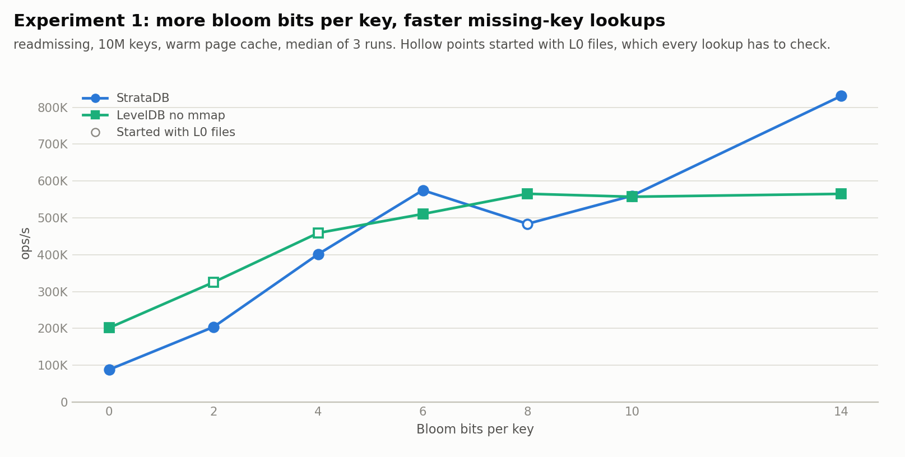
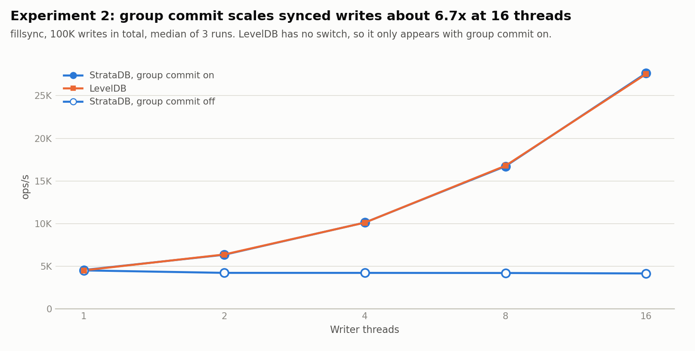
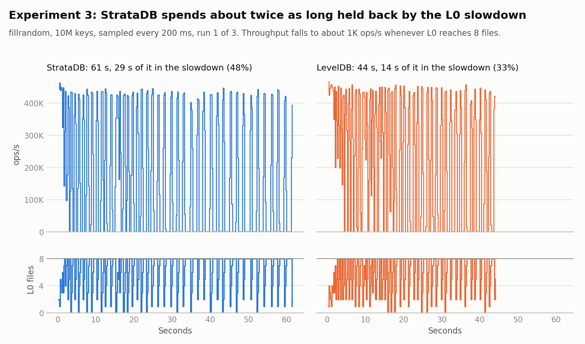
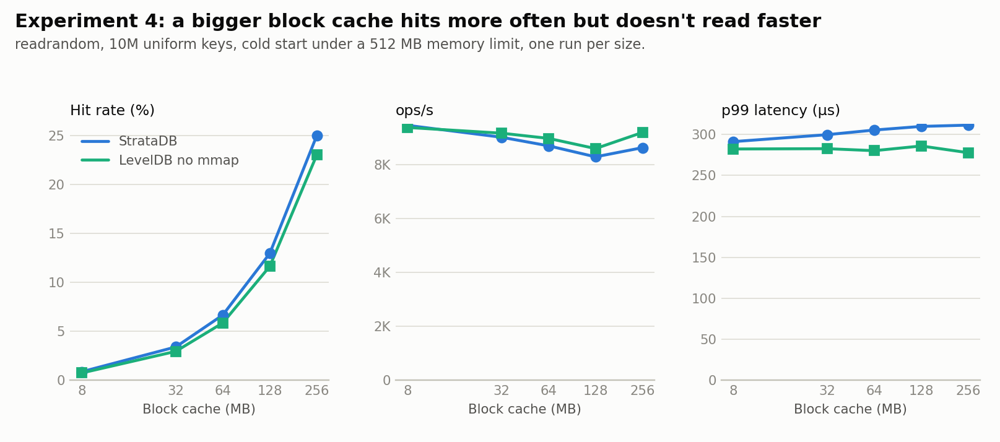
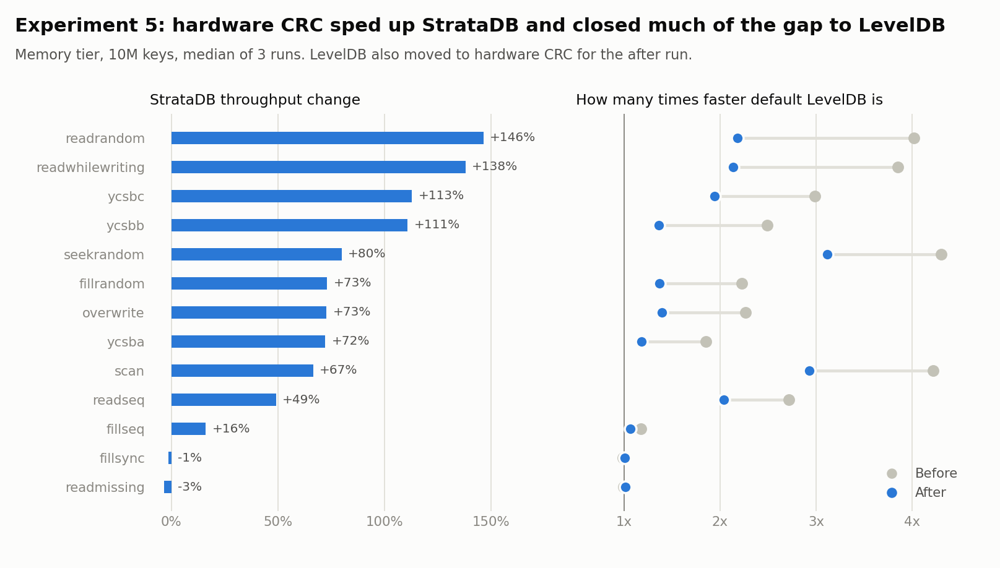

# Benchmarks

> **LevelDB is still ahead on most workloads, by less after a CRC fix.** These are 10M-key results from 6–7 November 2026. Profiling found that CRC took up to 60% of StrataDB's CPU, and fixing that raised its in-memory reads by 49–146%, other than `readmissing`, and its random writes by 73%. With both engines reading through `pread` and using hardware CRC, LevelDB is 1.3–2.1x faster on in-memory reads other than `readmissing`, and 1.4x faster on random writes. On disk they tie on `readrandom` and `ycsbc`, LevelDB leads `seekrandom` and `scan` by about 15%, and StrataDB leads `readmissing` by 14%.

Earlier versions of this page reported large StrataDB wins, including a 34x lead on `readmissing` and a reversal of the gap on disk. **Those claims are withdrawn.** They came from 1M-key runs on WSL2, with a flaw in how the missing keys were generated and wrong write amplification figures. The fixes are in commit `d3ea10a`.

## Environment

| Item | Value |
|---|---|
| Machine | Azure `Standard_D4ds_v4`, Malaysia West |
| CPU | Intel Xeon Platinum 8272CL, 2 cores and 4 threads |
| RAM | 16 GiB |
| Disk | 150 GiB local temp SSD, not exposed as NVMe; Microsoft lists a 250 MBps limit, and `fio` measured 236 MiB/s (about 247 MB/s) at most and 8,264 IOPS for 4 KB reads at queue depth 1 |
| Filesystem | ext4, `noatime` |
| Read-ahead | 128 KB during runs (the image's default is 4 MB) |
| OS | Ubuntu 24.04, kernel 7.0.0-1017-azure |
| Compiler | GCC 13.3, `-O2 -g -DNDEBUG -fno-omit-frame-pointer` |
| LevelDB | 1.23, with `google/crc32c` 1.1.2, without snappy or tcmalloc (the before run had no crc32c) |
| StrataDB | commit `ff46108`, which adds the CRC fix (the before run was `d3ea10a`) |

Each run also saves its own `environment.txt` with the results. This series can land on different Intel CPUs, so compare only numbers from the same CPU model.

Both runs used a source tree that hadn't been committed yet, so the `commit` column in the CSVs and `environment.txt` shows the parent: `2cdc2eb` for the before run and `d605da2` for the after run. Each run's `source_tree.txt` records the tree it measured. The before run's `8b18cbe` is the tree of `d3ea10a`. The after run's `d6e79b6` is the tree of `ff46108` plus a stray `bench/__pycache__` file that has no effect on the build.

## How to reproduce

Use Ubuntu 24.04, because the build needs CMake 3.25 or newer.

```bash
sudo apt-get update && sudo apt-get install -y build-essential cmake ninja-build git fio sysstat tmux
```

LevelDB only uses hardware CRC if `google/crc32c` is installed when it's configured. Ubuntu 24.04 doesn't package it, so build it from source:

```bash
git clone --depth 1 --branch 1.1.2 https://github.com/google/crc32c.git
```

```bash
cmake -S crc32c -B crc32c/build -DCMAKE_BUILD_TYPE=Release -DBUILD_SHARED_LIBS=ON -DCRC32C_BUILD_TESTS=OFF -DCRC32C_BUILD_BENCHMARKS=OFF -DCRC32C_USE_GLOG=OFF
```

```bash
cmake --build crc32c/build -j4 && sudo cmake --install crc32c/build && sudo ldconfig
```

Each run prints `crc32c=yes` or `crc32c=no` for LevelDB, so check that line. If you installed the library after configuring, reconfigure with `cmake --fresh --preset bench`.

Check that the temp disk is the roughly 150 GiB device mounted at `/mnt`:

```bash
lsblk -o NAME,SIZE,TRAN,MODEL,MOUNTPOINT
```

```bash
sudo mount -o remount,noatime /mnt
```

```bash
sudo mkdir -p /mnt/strata && sudo chown "$USER:$USER" /mnt/strata
```

Do a quick dry run with one pass over 1M keys, then the full run inside `tmux`:

```bash
./bench/run_benchmarks.sh --dry-run --runs=1 --db-dir=/mnt/strata/dry --output-dir=results-dry
```

```bash
./bench/run_benchmarks.sh --num=10M --sync-num=100K --disk-engines=strata,leveldb-nommap --db-dir=/mnt/strata/data --output-dir=docs/results/after
```

This took about 6 hours and 45 minutes here. Leaving out `--disk-engines` also runs default LevelDB on disk, which took the run to about 14 hours and 15 minutes. The script needs passwordless `sudo`. Any failed or stuck workload stops it with a non-zero exit, and it writes its checks and tables to `summary.md`. To recheck existing results without running anything:

```bash
./bench/run_benchmarks.sh --report-only --output-dir=docs/results/after
```

To see what the disk was doing during each disk-tier workload:

```bash
python3 bench/iostat_by_workload.py docs/results/after
```

## Method

Keys are 16 bytes and values 100 bytes, with no compression on either engine and checksums verified on every block read. Each number is the median of 3 runs on the same snapshot, with the engine order alternating between runs.

- **Memory tier:** no memory limit and a warm page cache, so disk reads don't affect the numbers.
- **Disk tier:** a 512 MB cgroup limit on a dataset of about 1.2 GB, with the page cache dropped before each run, so reads reach the disk.

Read workloads run LevelDB twice, because it reads through `mmap` by default and StrataDB uses `pread`:

- **LevelDB:** the default, with `mmap`. Its data blocks don't use its block cache, and its index and filter blocks can be evicted under memory pressure.
- **LevelDB no mmap:** `pread`, the same read path as StrataDB. This is the cleaner engine comparison.

### Known limits

- The disk's throughput limit caps default LevelDB on `readrandom`, `seekrandom`, `scan` and `ycsbc` in the disk tier. Those numbers measure the Azure limit, as [Disk I/O](#disk-io) shows, so they shouldn't be read as LevelDB's speed. That's why it isn't in the current disk tier.
- The LSM shape isn't controlled. Datasets settle wherever compaction leaves them, and StrataDB's start with 3 L0 files where LevelDB's have 0, which costs StrataDB some read speed.
- `fillsync` measures this temp disk's flush speed, which may not reflect durable storage elsewhere.
- LevelDB compacts in response to reads and StrataDB doesn't, so LevelDB's LSM shape can change during a read workload.
- YCSB records here are 116 bytes, not YCSB's standard 1 KB, so they line up with the other workloads.
- YCSB keys use Gray's Zipfian approximation at theta 0.99, scrambled with `fnv1a(rank) % n`. Only about 46% of keys can be drawn at 1M keys, where a random hash would reach 63%.

## Results

These are for the current code, with hardware CRC in both engines. All figures are medians of 3 runs. The raw data, per-run logs and generated tables are in [`docs/results/after/`](results/after/), and the run from before the fix is in [`docs/results/before/`](results/before/). Ratios above 1 mean LevelDB is faster.

### Memory tier

| Workload | Ops | StrataDB ops/s | LevelDB ops/s | LevelDB no mmap ops/s | LevelDB ÷ StrataDB | No mmap ÷ StrataDB |
|---|---|---|---|---|---|---|
| `fillseq`* | 10,000,000 | 548,149 | 585,046 | – | 1.07 | – |
| `fillrandom` | 10,000,000 | 164,362 | 225,638 | – | 1.37 | – |
| `overwrite` | 10,000,000 | 126,410 | 176,692 | – | 1.40 | – |
| `fillsync` | 100,000 | 4,498 | 4,529 | – | 1.01 | – |
| `readseq` | 10,000,000 | 2,250,617 | 4,595,953 | – | 2.04 | – |
| `readrandom` | 10,000,000 | 145,822 | 318,467 | 193,805 | 2.18 | 1.33 |
| `readmissing` | 10,000,000 | 563,898 | 572,516 | 559,352 | 1.02 | 0.99 |
| `seekrandom` | 10,000,000 | 45,785 | 142,732 | 90,505 | 3.12 | 1.98 |
| `scan` | 1,000,000 | 15,947 | 46,657 | 33,834 | 2.93 | 2.12 |
| `ycsbc` | 10,000,000 | 180,979 | 351,284 | 243,851 | 1.94 | 1.35 |
| `ycsbb` | 10,000,000 | 228,618 | 312,108 | – | 1.37 | – |
| `ycsba` | 10,000,000 | 269,012 | 317,836 | – | 1.18 | – |
| `readwhilewriting`† | 10,000,000 | 137,009 | 292,767 | – | 2.14 | – |

\* `fillseq` is the only workload with a spread over 10%. LevelDB's three runs were 461,435, 589,264 and 585,046 ops/s, so treat this ratio as rough. Its first run was low in the earlier run too. Every other workload stayed within 5.4%.

† StrataDB's run lasted longer, so its background writer wrote 2.1x as much data during it. This makes the comparison harder on StrataDB.

Latency in microseconds:

| Workload | p50 StrataDB | p50 LevelDB | p50 no mmap | p99 StrataDB | p99 LevelDB | p99 no mmap |
|---|---|---|---|---|---|---|
| `fillrandom` | 1.88 | 1.85 | – | 5.77 | 5.46 | – |
| `overwrite` | 1.86 | 1.93 | – | 6.67 | 6.02 | – |
| `fillsync` | 210.93 | 209.98 | – | 430.45 | 429.25 | – |
| `readrandom` | 6.46 | 2.87 | 4.87 | 12.90 | 5.48 | 7.89 |
| `readmissing` | 1.39 | 1.42 | 1.46 | 7.84 | 3.29 | 6.26 |
| `seekrandom` | 19.90 | 5.91 | 9.68 | 33.86 | 8.55 | 20.38 |
| `scan` | 60.54 | 20.06 | 28.11 | 78.64 | 32.31 | 42.96 |
| `ycsbc` | 6.13 | 2.66 | 4.57 | 12.21 | 4.97 | 7.25 |

### Disk tier

Default LevelDB wasn't rerun here, because the disk's limit sets its numbers and hardware CRC can't change them. [Disk I/O](#disk-io) has its figures from the earlier run.

| Workload | Ops | StrataDB ops/s | LevelDB no mmap ops/s | No mmap ÷ StrataDB |
|---|---|---|---|---|
| `readrandom` | 10,000,000 | 9,410 | 9,412 | 1.00 |
| `readmissing` | 10,000,000 | 351,968 | 309,967 | 0.88 |
| `seekrandom` | 10,000,000 | 7,271 | 8,269 | 1.14 |
| `scan` | 1,000,000 | 3,203 | 3,669 | 1.15 |
| `ycsbc` | 10,000,000 | 20,823 | 20,976 | 1.01 |

Every disk workload stayed within 2.5% across its runs. `readmissing` takes under 40 seconds, because it rarely touches the disk, so it's the least settled of these.

Latency in microseconds:

| Workload | p50 StrataDB | p50 no mmap | p99 StrataDB | p99 no mmap |
|---|---|---|---|---|
| `readrandom` | 125.42 | 124.01 | 292.34 | 278.76 |
| `readmissing` | 1.53 | 1.62 | 9.50 | 7.35 |
| `seekrandom` | 145.83 | 132.46 | 338.06 | 310.64 |
| `scan` | 327.95 | 289.25 | 813.60 | 758.84 |
| `ycsbc` | 9.23 | 7.32 | 258.06 | 250.63 |

### Disk I/O

`iostat` sampled the disk every 5 seconds through the disk tier. With no database running, `fio` tops out at 236 MiB/s on this disk ([`fio_cap.txt`](results/before/fio_cap.txt)). The default LevelDB rows come from the [earlier run](results/before/iostat_by_workload.txt), and the others from the [current one](results/after/iostat_by_workload.txt).

| Workload | Engine | Ops/s | Read MiB/s | Samples near the limit | Reads per op | KB per op |
|---|---|---|---|---|---|---|
| `readrandom` | StrataDB | 9,410 | 67.6 | 0% | 0.83 | 7.4 |
| | LevelDB no mmap | 9,412 | 68.4 | 0% | 0.84 | 7.4 |
| | LevelDB, earlier run | 3,726 | 235.6 | 100% | 0.79 | 64.7 |
| `seekrandom` | StrataDB | 7,271 | 53.9 | 0% | 0.87 | 7.6 |
| | LevelDB no mmap | 8,269 | 61.3 | 0% | 0.87 | 7.6 |
| | LevelDB, earlier run | 3,134 | 235.6 | 100% | 1.35 | 77.0 |
| `scan` | StrataDB | 3,203 | 117.9 | 0% | 2.43 | 37.7 |
| | LevelDB no mmap | 3,669 | 135.4 | 0% | 2.42 | 37.8 |
| | LevelDB, earlier run | 2,930 | 235.1 | 100% | 1.44 | 82.2 |
| `ycsbc` | StrataDB | 20,823 | 59.5 | 0% | 0.34 | 2.9 |
| | LevelDB no mmap | 20,976 | 61.3 | 0% | 0.35 | 3.0 |
| | LevelDB, earlier run | 6,729 | 235.6 | 100% | 0.46 | 35.8 |

"Near the limit" means at least 95% of 236 MiB/s. Two things follow from this table:

- **Default LevelDB's disk numbers are set by the Azure limit.** It reads 2–12x as much per operation as the `pread` rows, because page faults on `mmap` pull in read-ahead, and it holds at the limit for the whole run. Its throughput barely changes between runs either: 3,134 ops/s on `seekrandom` in all three. StrataDB's lead over these rows isn't an engine result, and a faster disk would change it.
- **StrataDB and LevelDB no mmap do the same I/O.** Their reads and KB per operation match, so where they differ on disk, it isn't extra I/O. See [below](#where-leveldb-wins-and-why).

## Amplification

Table bytes written per byte of keys and values written, with one denominator for both engines. The WAL isn't counted.

| Workload | User data | StrataDB | LevelDB |
|---|---|---|---|
| `fillseq` | 1,106.3 MiB | 1.00 | 1.00 |
| `fillrandom` | 1,106.3 MiB | 9.14 | 9.06 |
| `overwrite` | 1,106.3 MiB | 11.37 | 11.06 |

The two engines are within 3% of each other, so compaction volume doesn't explain the gap in write throughput.

These three aren't comparable between engines, because read-triggered compaction affects LevelDB and, for `readwhilewriting`, the amount written differs:

| Workload | StrataDB user data | LevelDB user data | StrataDB | LevelDB |
|---|---|---|---|---|
| `ycsba` | 553.3 MiB | 553.3 MiB | 6.19 | 11.58 |
| `ycsbb` | 55.3 MiB | 55.3 MiB | 8.14 | 124.64 |
| `readwhilewriting` | 80.7 MiB | 37.8 MiB | 6.11 | 34.46 |

## Experiments

These all use the current code, and LevelDB has hardware CRC. To rerun them and redraw the charts:

```bash
./bench/run_experiments.sh --db-dir=/mnt/strata/exp --output-dir=docs/results/experiments
```

```bash
python3 bench/plot_experiments.py
```

The CSVs are in [`docs/results/experiments/`](results/experiments/). Experiments 1–3 were run 3 times each. Experiment 4 was run once per size, because `readrandom` on disk stayed within 1.1% across runs earlier and a full set of 3 would take about 9 hours.

### 1. Bloom bits per key vs `readmissing`



| Bits per key | StrataDB ops/s | StrataDB L0 files | LevelDB no mmap ops/s | LevelDB L0 files |
|---|---|---|---|---|
| 0 | 88,222 | 0 | 201,513 | 0 |
| 2 | 204,094 | 0 | 325,530 | 2 |
| 4 | 401,668 | 0 | 459,150 | 3 |
| 6 | 575,128 | 0 | 510,584 | 0 |
| 8 | 483,884 | 3 | 565,461 | 0 |
| 10 | 560,004 | 3 | 557,381 | 0 |
| 14 | 830,929 | 0 | 565,216 | 0 |

LevelDB flattens out from about 8 bits, while StrataDB keeps gaining up to 14. That fits their designs: StrataDB checks one whole-file filter before touching the index, while LevelDB searches the index first and then checks a per-block filter.

This experiment has a flaw: the L0 file count wasn't controlled, and it differs between datasets because each has its own compaction timing. Every missing-key lookup has to check each L0 file that covers the key. StrataDB's points with no L0 files rise steadily, and its dip at 8 bits is one of the two points with 3 L0 files, so that dip most likely comes from the shape, not the filter. For the same reason, compare the two engines at a given bit count with care.

### 2. `fillsync` throughput, 1–16 threads, with and without group commit



| Threads | StrataDB, group commit on | LevelDB | StrataDB, group commit off |
|---|---|---|---|
| 1 | 4,559 | 4,517 | 4,512 |
| 2 | 6,345 | 6,378 | 4,223 |
| 4 | 10,122 | 10,115 | 4,221 |
| 8 | 16,719 | 16,779 | 4,208 |
| 16 | 27,634 | 27,532 | 4,153 |

At 16 threads, group commit gives 6.7x the throughput of syncing each write alone. StrataDB and LevelDB match within 1% at every thread count. Median latency rises from about 208 µs to 584 µs with group commit, and to 3,793 µs without it.

### 3. Throughput and L0 file count over a 10M `fillrandom`



Medians of 3 runs:

| Engine | Total time | Time in the L0 slowdown | Throughput outside it |
|---|---|---|---|
| StrataDB | 61.4 s | 29.2 s (48%) | 311,470 ops/s |
| LevelDB | 44.3 s | 14.4 s (32%) | 326,151 ops/s |

"In the slowdown" means a 200 ms sample under 2,000 ops/s. Both engines delay each write by 1 ms once L0 reaches 8 files, which holds throughput near 1,000 ops/s. Neither reached the 12-file hard stop.

This explains nearly all of the `fillrandom` gap. Outside the slowdown the engines are within 5%, and StrataDB's extra 17 seconds are almost entirely the extra 15 seconds it spends slowed down.

### 4. Block cache size vs `readrandom` hit rate and p99



| Cache | StrataDB hit rate | StrataDB ops/s | StrataDB p99 | No mmap hit rate | No mmap ops/s | No mmap p99 |
|---|---|---|---|---|---|---|
| 8 MB | 0.9% | 9,459 | 291.30 µs | 0.7% | 9,380 | 282.31 µs |
| 32 MB | 3.4% | 9,017 | 299.80 µs | 2.9% | 9,167 | 282.69 µs |
| 64 MB | 6.7% | 8,698 | 305.44 µs | 5.8% | 8,975 | 280.24 µs |
| 128 MB | 12.9% | 8,289 | 309.89 µs | 11.6% | 8,596 | 285.97 µs |
| 256 MB | 25.0% | 8,630 | 311.44 µs | 23.0% | 9,195 | 277.77 µs |

The keys here are uniform, so the hit rate simply tracks how much of the data fits in the cache. Hits didn't make reads faster, and StrataDB got up to 12% slower. My best explanation is that the block cache and the page cache share the 512 MB limit, so a larger block cache mostly takes memory from the page cache, but I didn't measure the disk reads during this experiment. Skewed keys would likely show a different result, and I haven't run that.

### 5. Profiling pass: before and after



`perf` sampled `cpu-clock` at 999 Hz, because Azure doesn't expose hardware counters on this VM size. The top hotspot was `crc32c::Extend`, a byte-at-a-time software CRC. The fix uses the CPU's CRC32 instruction when it has one and slicing-by-8 otherwise. Both produce the same values, so the file format hasn't changed.

Share of StrataDB's CPU samples spent computing CRC:

| Workload | Before | After |
|---|---|---|
| `fillrandom` | 38.75% | 2.99% |
| `overwrite` | 40.66% | 3.09% |
| `readrandom` | 59.62% | 6.66% |
| `seekrandom` | 55.81% | 6.45% |
| `scan` | 50.63% | 4.73% |

Memory tier, StrataDB ops/s, and the gap to LevelDB:

| Workload | Before | After | Change | No mmap ÷ StrataDB, before | After |
|---|---|---|---|---|---|
| `fillrandom` | 94,916 | 164,362 | +73% | 2.23‡ | 1.37‡ |
| `overwrite` | 73,149 | 126,410 | +73% | 2.27‡ | 1.40‡ |
| `readrandom` | 59,160 | 145,822 | +146% | 2.74 | 1.33 |
| `seekrandom` | 25,443 | 45,785 | +80% | 3.17 | 1.98 |
| `scan` | 9,569 | 15,947 | +67% | 3.23 | 2.12 |
| `ycsbc` | 85,015 | 180,979 | +113% | 2.49 | 1.35 |
| `readmissing` | 583,172 | 563,898 | −3% | 0.97 | 0.99 |

‡ Compared with default LevelDB, because write workloads have no `pread` variant.

On disk, StrataDB gained 12–15% on the workloads that read data blocks, and it now ties LevelDB no mmap on `readrandom` and `ycsbc`. The overwrite p99 fell from 1,002 µs to 6.67 µs, because fewer than 1% of writes now hit the slowdown.

- **Both engines changed.** The before run has software CRC on both, and the after run has hardware CRC on both, using `google/crc32c` 1.1.2 for LevelDB. LevelDB gained up to 38% from this, so the gaps above understate how much StrataDB gained in absolute terms.
- **The datasets aren't identical.** They were rebuilt, so StrataDB started from `3/6/60/488` files per level, not `2/5/53/490`. Both runs used the same VM.

Flame graphs for [`readrandom` before](results/profiles/before/strata_readrandom.svg) and [after](results/profiles/after/strata_readrandom.svg), with the others in [`docs/results/profiles/`](results/profiles/). `bench/profile.sh` reproduces them.

## Where LevelDB wins, and why

The profiles and experiments point to these causes. The first is measured directly, and the others are my reading of the data, which I haven't tested by changing the code.

**Random writes lose time in the L0 slowdown.** Experiment 3 shows this directly. Why StrataDB's compaction falls further behind is still open. The two engines write the same volume, so it isn't extra work in that sense. Two differences are candidates: LevelDB can place a flushed file below L0 when nothing overlaps, and StrataDB's iterators, which compaction also uses, cost more per key.

**Seeks and scans pay for iterator layers.** These have the largest remaining gaps, at about 2x LevelDB no mmap in memory. In the `scan` profile, 24.3% of samples are in `MergingIterator::FindSmallest` plus the `key()` and `Valid()` calls that `TwoLevelIterator`, `OwningBlockIterator` and `TableIteratorWrapper` forward to each other. Those are virtual calls through several layers on every step. LevelDB's `IteratorWrapper` caches the key and validity, which avoids most of them. StrataDB's datasets also start with 3 L0 files against LevelDB's 0, so every seek merges more sources.

**Point reads have no single hotspot left.** No function in the `readrandom` profile is above 9%. The extra time over LevelDB no mmap is down to about 1.7 µs per lookup in memory, and it disappears on disk, where both average 105.8 µs. Default LevelDB stays ahead in memory because `mmap` avoids the `pread` system call and the copy, and that copy is the largest single item left in StrataDB's profile.

| Workload | Extra time per op over no mmap, memory | Disk |
|---|---|---|
| `readrandom` | 1.7 µs | 0.0 µs |
| `seekrandom` | 9.9 µs | 15.6 µs |
| `scan` | 32.3 µs | 38.6 µs |
| `ycsbc` | 1.4 µs | 0.4 µs |

**Where StrataDB leads.** On disk `readmissing` it's 14% ahead of LevelDB no mmap, with a better p50 (1.53 vs 1.62 µs) and a worse p99 (9.50 vs 7.35 µs). At 14 bloom bits per key it's 47% ahead in memory, helped by checking the filter before the index.
